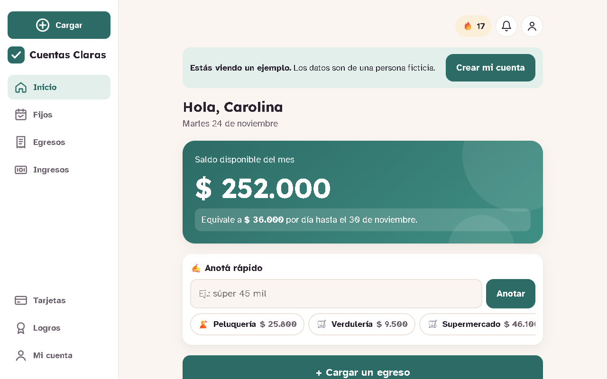

# Cuentas Claras

App web de finanzas personales (PWA) para anotar ingresos y egresos, controlar gastos fijos y tarjetas, y saber cuánto queda disponible en el mes. Hecha para un grupo real de usuarias, con suscripción mensual cobrada por Mercado Pago.



## Funcionalidades

- **Carga rápida en texto libre**: "súper 45 mil" se interpreta como un egreso de $45.000 en la categoría Supermercado.
- **Ingresos, egresos y gastos fijos**, con sugerencias y saldo disponible por día hasta fin de mes.
- **Tarjetas de crédito**: cuotas asignadas al mes de pago según la fecha de cierre, descuentos, reintegros e intereses.
- **Notificaciones push** (Web Push): recordatorio diario, vencimientos, día de cobro y resumen mensual.
- **Suscripciones con Mercado Pago**: período de prueba, alta y renovación automáticas mediante **webhooks** con verificación de firma.
- **Cuentas de usuario** con login, recuperación de contraseña por mail, logros y rachas.
- **Panel de administración**: usuarias, estado de pago, precio y días de prueba.
- **Copias de seguridad** diarias de la base, también enviadas por mail.

## Stack

| Capa | Tecnología |
|---|---|
| Backend | Python 3, Flask, Waitress |
| Base de datos | SQLite |
| Frontend | JavaScript, HTML, CSS, PWA (service worker, manifest) |
| Integraciones | API de Mercado Pago (webhooks), Web Push (pywebpush), SMTP |
| Calidad | pytest (43 tests) |
| Deploy | Docker, Railway |

## Arquitectura

```
cuentas/
  server.py      API REST (Flask) y autenticación
  core.py        reglas de negocio: saldo, gastos fijos, tarjetas y cuotas
  db.py          esquema SQLite y migraciones
  pagos.py       suscripciones y webhooks de Mercado Pago
  push.py        notificaciones Web Push
  scheduler.py   tareas programadas (avisos, resúmenes, copias)
  logros.py      logros y rachas
  mail.py        envío de mails
  static/        frontend PWA
tests/           tests de API, pagos, avisos, tarjetas y carga rápida
```

## Cómo correrlo

```bash
pip install -r requirements.txt
python run.py
```

Abrir `http://127.0.0.1:8780` y entrar con **"Ver un ejemplo sin registrarme"** (datos ficticios).

Con Docker:

```bash
docker build -t cuentas-claras .
docker run -p 8080:8080 -v cuentas-datos:/data cuentas-claras
```

## Tests

```bash
python -m pytest
```

Cubren registro y login, cálculo de saldos, gastos fijos, tarjetas y cuotas, la carga rápida, los avisos programados y el procesamiento de webhooks de pago.

## Deploy

Pasos para publicarla en Railway, variables de entorno y configuración de Mercado Pago: [docs/DEPLOY.md](docs/DEPLOY.md).
